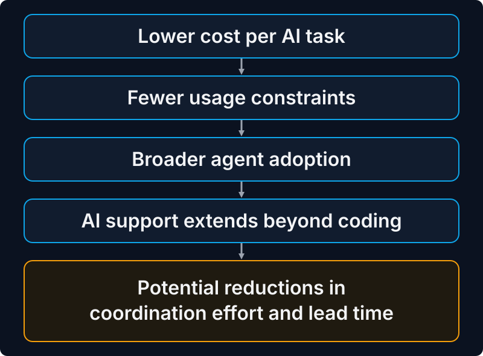

What does it take for a European digital bank to make a Chinese-developed AI model the default for its software engineering?

Revolut has done exactly that. After experimenting with commercial coding assistants, including Claude Code, the company moved towards running GLM, an open-weight model developed by China's Z.ai, on dedicated GPUs. The reported economics are striking: approximately 2,000 engineers supported by 56 NVIDIA B200 GPUs, with AI inference costs falling to around one-tenth of previous spending on commercial model services.

Revolut also reports substantial improvements in engineering productivity. On the chart it presented, lead time fell from about 4.4 days at the start of 2025 to about 1.8 days, and coding time from about 20 hours to under 4. These improvements accumulated over a longer period and cannot be attributed specifically to the switch from Claude Code to GLM.

At [AI Engineer NYC 2026](https://ai.engineer/nyc/2026/talks/revolut), David Abitbol presented the company's journey and the technical choices behind it. The case raises questions extending well beyond Revolut: How much does the underlying AI model matter compared with the way organisations use it? Can open-weight models fundamentally change the economics of software engineering? And what does technological autonomy mean when a European financial institution relies on Chinese-developed AI?

## From AI assistants to engineering agents

Revolut's experience did not begin with GLM or even with modern coding agents. The company introduced Gemini in early 2025, giving engineers access to AI for tasks such as retrieving information and working with internal documentation. According to Abitbol, this initial phase was associated with approximately 20% improvement in coding time and 10% improvement in engineering lead time.

The company subsequently experimented with agentic coding tools and introduced Claude Code at scale in January 2026. However, the economics were challenging. Some developers generated substantial monthly model costs, prompting Revolut to impose usage budgets. In a separate presentation at NVIDIA GTC Berlin, Abitbol described a budget of approximately $300 per engineer per month, which proved restrictive for intensive agentic coding. Developers consequently had an incentive to reserve their AI allowance for tasks where the benefits were most obvious, rather than using agents throughout the engineering workflow.

Around April 2026, Revolut began self-hosting GLM models, making AI usage substantially less expensive and more predictable. By the time of Abitbol's presentation, open-weight models had become the default for agentic engineering, while commercial frontier models remained available for tasks requiring their capabilities.

### What happened to engineering productivity?

Revolut's own productivity chart is particularly informative because it shows how engineering performance evolved over time.

The chart illustrates a substantial reduction in both measures over the observation period. Coding time represents the hours spent developing a feature, while engineering lead time measures the elapsed time from an engineer picking up a feature until it is merged and ready for deployment.

Abitbol summarised the improvements as 70% in lead time and 60% in coding time without stating a baseline, and the exact percentage depends on the starting point. **These changes should not be interpreted as the productivity difference between Claude Code and GLM.** The Claude Code deployment was relatively short and operated under restrictive usage budgets. Meanwhile, model capabilities, engineering practices, adoption levels and organisational experience were all evolving.

The chart also shows fluctuations rather than a perfectly smooth improvement trajectory. The sharp reductions during 2026 are interesting, but the observational data do not establish how much of the improvement was caused by changing models, removing usage limits or other developments. What the evidence does support is that Revolut experienced substantial improvements during its broader AI adoption journey, alongside a transition towards more affordable and less restricted agentic engineering.

Abitbol's own conclusion is that coding is no longer the bottleneck, because engineers used their freely available tokens more for non-coding tasks. The chart offers some support: lead time fell by about 2.6 days and coding time by about 16 hours. Even counted as eight-hour working days, that is more time than was saved on coding, although the two measures may not be directly comparable. The effects of AI adoption may therefore extend beyond code generation itself.

## The real bottleneck may be outside coding

Software engineering involves considerably more than writing code. Developers spend time understanding requirements, searching for information, investigating defects, coordinating with colleagues, navigating internal systems and preparing changes for integration and deployment. Faster code generation does not automatically eliminate delays elsewhere in this process.

Abitbol highlighted the potential benefits of using AI agents for activities involving Jira, Confluence, Slack and other information systems surrounding development work. These activities help explain why making AI widely available could affect overall engineering lead time, not only coding time.

Lower inference costs may also change how engineers approach their work. When AI usage is expensive or constrained by individual budgets, developers have an incentive to use agents selectively. More affordable and predictable inference can encourage experimentation and make it practical to use AI across a broader range of engineering activities.

This distinction matters when companies evaluate the productivity effects of AI. Measuring how quickly developers generate code may overlook improvements elsewhere in the delivery process. Conversely, faster code generation may provide limited organisational benefit when requirements clarification, testing, review, integration or decision-making remain bottlenecks.

For the future of software work, the question is increasingly how AI changes the organisation of engineering activities and the division of labour between people and agents.

## The economics: 2,000 engineers, 56 GPUs

According to Abitbol, Revolut serves approximately 2,000 engineers on 56 NVIDIA B200 GPUs at a blended cost of approximately $0.30 per million tokens. What would it cost to buy infrastructure of this scale? NVIDIA does not publish a standard list price for B200 systems, but [American Compute's 2026 GPU pricing benchmark](https://www.amcompute.com/gpu-prices) estimates that an integrated server containing eight B200 GPUs costs approximately **$360,000–$470,000**. Revolut's 56 GPUs correspond to seven such servers, suggesting an indicative cost of **$2.5–3.3 million** for buying comparable hardware, or roughly **$2.9 million at the midpoint**.

The $2.5–3.3 million figure is an estimate based on publicly available server prices. It only illustrates the scale involved: Revolut has not reported this cost, and neither presentation indicates that it bought the hardware. It covers the GPU servers, including their processors, memory, storage and node-level networking, but excludes shared cluster networking, additional data-centre infrastructure, installation, electricity, cooling, maintenance and the engineering effort required to operate and optimise the system. The total investment and ongoing operating costs would therefore be higher. The presentation also does not establish how much of Revolut's total AI infrastructure this capacity represents.

Having the GPUs is only the starting point. According to Abitbol, simply loading model weights onto them delivers poor performance, so Revolut invested in optimising model serving, including quantisation, parallelisation, caching and inference configuration. On the same GPU fleet, time to first token fell from approximately 14.3 seconds to 1.7 seconds (Figure 3).

For interactive coding agents, response latency matters. An agent that responds too slowly can disrupt the developer's workflow, even when its model quality is otherwise sufficient. The infrastructure therefore needs to balance model capability, throughput, latency and cost.

**Figure 3. Inference optimisation without additional GPUs**

| Metric | Reported change |
|---|---:|
| Requests processed per second | +76% |
| Time to first token | −88% |
| GPU fleet | Unchanged |

*Source: Revolut's AI Engineer NYC presentation. These improvements concern inference-system performance, not engineering productivity.*

These results demonstrate why published model prices are an incomplete basis for comparing AI strategies. Revolut's reported $0.30 per million tokens is a deployment-specific result, not a universal price for running GLM.

The economics are also closely connected to scale. A company serving thousands of engineers can distribute infrastructure costs across a large user base and potentially achieve high GPU utilisation. Smaller organisations with irregular workloads may face a very different cost structure, even when using exactly the same model.

## A Chinese model inside a European bank

One of the most notable aspects of Revolut's strategy is its choice of model. GLM is developed by [Z.ai (Zhipu AI)](https://z.ai/), a Chinese AI company. For a regulated financial institution operating in an environment where security, confidentiality and compliance are particularly important, this is an interesting decision.

The choice illustrates an important distinction between the origin of an AI model and the location where it processes data. When an organisation uses a hosted AI API, requests are processed through infrastructure operated by the service provider, subject to the provider's technical and contractual arrangements. With self-hosted open-weight models, the organisation can instead deploy model weights in an environment under its chosen operational controls. This provides greater control over data processing, network connectivity, access management and retention policies.

Such control does not automatically guarantee security or regulatory compliance. Organisations still need to assess model provenance, software supply-chain risks, licensing, vulnerabilities and the behaviour of the agents using the models. Revolut's presentation describes safeguards around its engineering agents, but it does not constitute an independent security assessment of the deployment. In particular, running the weights on dedicated capacity avoids sending requests to the model developer, although any infrastructure provider remains part of the chain of trust, and risks associated with the model itself remain.

The case is relevant to discussions about European technological sovereignty. A company can use Chinese-developed model weights, American-designed computing hardware and infrastructure operated under European jurisdiction while retaining substantial control over its own data and deployment environment. At the same time, it may remain dependent on foreign model developers, hardware suppliers and software ecosystems.

Technological autonomy therefore cannot be assessed from model nationality alone. It depends on the organisation's ability to control critical operations, manage risks and retain alternatives when technologies or suppliers change.

## What changes when a company runs its own models?

Revolut's decision to self-host GLM changes the allocation of responsibilities between the AI provider and the company using the model. With commercial APIs, much of the model serving, infrastructure management and performance optimisation is handled by the provider. Self-hosting gives the organisation greater control over these decisions, but also makes it responsible for more of the inference system.

This trade-off extends beyond hardware. Revolut needs to manage model deployment, serving performance, capacity planning, updates and security, although the presentations do not detail how this work is shared with any infrastructure provider. It also needs the expertise to evaluate whether newer open-weight models offer sufficient improvements to justify switching. The reported 76% throughput improvement illustrates how much operational engineering can contribute to the economics of running AI models.

The choice is therefore partly about where an organisation wants to build capabilities. Commercial services allow companies to concentrate on using AI, while self-hosting can make infrastructure optimisation a source of competitive advantage. Whether this investment pays off depends on scale, utilisation and the organisation's ability to operate the system efficiently.

For companies considering a similar approach, the key question is not simply whether open-weight models are cheaper per token. It is whether the expected workload justifies taking responsibility for the infrastructure and expertise needed to deliver those tokens reliably.

## Can smaller software companies achieve similar economics?

Revolut's scale makes its example impressive, but also raises questions about generalisability. Most software companies cannot justify infrastructure that would cost millions to buy. With lower or irregular utilisation, commercial APIs or managed inference services may be less expensive overall. The comparison also needs to account for infrastructure management, security, monitoring, model evaluation and maintenance rather than token prices alone.

Fortunately, self-hosting and commercial frontier APIs are not the only options. The growing market for open-weight models and inference services offers several possible approaches.

### Comparing the alternatives

| Strategy | Potential benefit | Main consideration |
|---|---|---|
| Commercial frontier APIs | Access to leading capabilities with little infrastructure work | Usage costs and provider dependency |
| Hosted open-weight models | Flexible model choice without owning GPUs | Hosting provider, data location and service terms |
| Managed private inference | Greater control over deployment and data processing | Higher operating cost and integration requirements |
| Dedicated self-hosting | Control and potential economies of scale | Infrastructure investment, utilisation and expertise |
| Hybrid model routing | Use inexpensive models for routine tasks and frontier models selectively | Requires reliable evaluation and routing |

For many smaller companies, a hybrid approach may offer a practical balance. Routine coding and engineering tasks could be handled by inexpensive open-weight models, while more demanding tasks use frontier services. This would allow organisations to optimise costs without committing all workloads to a single model or provider.

Such an approach is not without complexity. Companies need ways to determine which tasks require stronger models, evaluate output quality and monitor the consequences of model changes. In practice, the ability to select and switch between models may become as important as the cost of running any individual model.

There is also a potentially important market opportunity for infrastructure providers. As open-weight models become more capable, specialised inference services could make some of Revolut's economic advantages accessible to smaller organisations without requiring them to build comparable infrastructure. European cloud providers, managed inference platforms and industry-specific AI services may have an important role in this development.

Whether these services can combine competitive pricing with adequate performance, security and reliability remains an open question. If they succeed, smaller companies could benefit from increasingly affordable AI capabilities. If not, the economies of scale associated with AI infrastructure may become another source of competitive advantage for large technology organisations.

## Who benefits from cheaper AI?

Revolut's experience illustrates how dramatically the economics of agentic software engineering can change when capable open-weight models are combined with optimised inference infrastructure. Lower costs may also change how AI is used: when engineers are no longer constrained by restrictive usage budgets, agents can become part of a wider range of activities across the development process.

Yet Revolut's results reflect more than access to an inexpensive model. Its scale, dedicated computing capacity and inference expertise all contribute to the reported savings. For smaller software companies, building comparable infrastructure is unlikely to make economic sense. Their opportunity may instead lie in the growing market for affordable hosted open-weight models and managed inference services.

This raises an important question for the software industry. As open-weight models improve and inference costs fall, will advanced AI capabilities become increasingly accessible to companies of all sizes, or will the greatest benefits continue to favour organisations with the resources to operate AI at scale?

---

### Sources and further reading

1. [David Abitbol, Revolut — AI Engineer NYC 2026](https://ai.engineer/nyc/2026/talks/revolut). Primary source for the productivity chart, deployment metrics, costs and technical discussion, with a machine-generated [transcript](https://ai.engineer/reading/nyc-2026/transcripts/david-abitbol-revolut.md). The slides appear in the [recording](https://www.youtube.com/watch?v=Ok6QdZHCcI8&t=16s).
2. [American Compute — GPU Prices 2026](https://www.amcompute.com/gpu-prices). Source for the estimated $360,000–$470,000 price of an integrated eight-GPU B200 server, used to calculate the indicative $2.5–3.3 million hardware cost.
3. [NVIDIA GTC Berlin 2026](https://www.nvidia.com/en-us/on-demand/session/gtcberlin26-sb61234/). David Abitbol, "How Revolut Runs Production Agents on Open Models: European Infrastructure, at a Fraction of the Cost (Presented by Together AI)". Source for the $300 monthly budget.
4. [Z.ai](https://z.ai/). Developer of the GLM model family.
